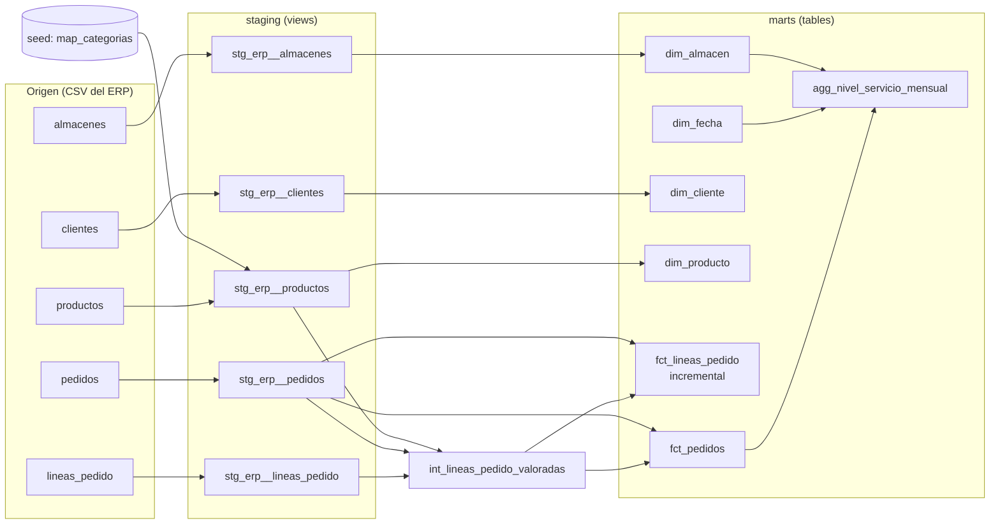

# Analítica logística con dbt

Proyecto de ejemplo de **analytics engineering** sobre una operación logística:
pedidos, almacenes, clientes y productos. Transforma datos crudos de un ERP
(simulado) en un modelo dimensional listo para BI, con tests de calidad,
carga incremental e integración continua.

  

## Qué resuelve

Responde preguntas típicas de una dirección de operaciones:

- ¿Qué **nivel de servicio** (pedidos entregados a tiempo) tiene cada almacén, mes a mes?
- ¿Cuánto se vende y cuánto peso se mueve por almacén, cliente, producto y familia?
- ¿Qué almacenes acumulan más retrasos y cuánto se retrasan en promedio?
- ¿Cuál es la tasa de cancelación?

## Arquitectura



| Capa | Materialización | Responsabilidad |
|---|---|---|
| **staging** | view | Una vista por tabla de origen: tipos, nombres, limpieza y normalización. Sin lógica de negocio. |
| **intermediate** | view | Lógica reutilizable: valorización de líneas (bruto, descuento, neto) y peso. |
| **marts** | table / incremental | Modelo estrella: dimensiones, hechos a nivel línea y pedido, y un agregado mensual para el dashboard. |
| **seeds** | table | Tablas de mapeo mantenidas por negocio (categorías → familias). |

## Problemas de datos que se resuelven

Los datos de origen traen a propósito problemas habituales de sistemas reales:

| Problema en origen | Dónde se resuelve | Cómo |
|---|---|---|
| Categorías y estados con mayúsculas/espacios inconsistentes | `stg_erp__productos`, `stg_erp__pedidos` | Macro `normalizar_texto` + mapeo con seed / `case` |
| Clientes duplicados (una fila por actualización) | `stg_erp__clientes` | `qualify row_number()` por fecha de actualización |
| Líneas con cantidad 0 (anuladas) | `stg_erp__lineas_pedido` | Filtro en staging |
| Pedidos cancelados que no deben contar como venta | `int_lineas_pedido_valoradas` | Excluidos de la valorización |

## Calidad de datos

`dbt build` ejecuta **58 nodos**, entre ellos **43 tests de datos y un unit test**:

- **Tests genéricos**: `unique`, `not_null`, `accepted_values` y `relationships` (integridad referencial entre hechos y dimensiones).
- **Test genérico propio**: `unique_combinacion` (unicidad de claves compuestas), en `macros/tests/`.
- **Tests singulares** (`tests/`):
  - `assert_importes_cuadran_entre_facts`: el importe total a nivel pedido coincide con la suma de las líneas.
  - `assert_entrega_no_anterior_al_pedido`: ninguna entrega es anterior a su pedido.
- **Unit test** (`_marts.yml`): valida la regla de negocio de "entregado a tiempo" con casos controlados (a tiempo, con retraso, adelantado, sin entregar).

## Carga incremental

`fct_lineas_pedido` es **incremental** (`delete+insert` por `pedido_id` + `linea`).
En cada corrida reprocesa los últimos `dias_reproceso` días (variable, 7 por defecto)
para capturar líneas que llegan o cambian con retraso, sin recalcular toda la historia.

## Integración continua

El workflow `.github/workflows/dbt-ci.yml` se ejecuta en cada push y pull request:

1. Instala dependencias.
2. Genera los datos de origen.
3. Ejecuta `dbt build` (modelos + tests + unit tests).
4. Repite el build de la fact incremental para validar la segunda carga.

## Cómo ejecutarlo

Requisitos: Python 3.10 o superior.

```bash
python -m venv .venv
# Windows: .venv\Scripts\activate   ·   Linux/Mac: source .venv/bin/activate
pip install -r requirements.txt

python scripts/generar_datos.py        # genera data/raw/*.csv (20.000 pedidos)
dbt build --profiles-dir .             # construye y testea todo
dbt docs generate --profiles-dir .     # documentación y lineage
dbt docs serve --profiles-dir .
```

El resultado queda en `logistica.duckdb` y se puede consultar con cualquier cliente
de DuckDB o conectar a una herramienta de BI.

## Decisiones de diseño

- **DuckDB** como motor: corre local sin infraestructura, así cualquiera puede reproducir el proyecto. Los modelos usan SQL estándar y se migran a Snowflake, Databricks o BigQuery con cambios mínimos.
- **Las fuentes se leen directo desde CSV** (`external_location` de dbt-duckdb), sin un paso de carga intermedio.
- **Los pedidos cancelados se mantienen en `fct_pedidos`** (con importe 0) para poder medir la tasa de cancelación, y se excluyen de las líneas valorizadas.
- **El nivel de servicio se calcula sobre pedidos entregados**: los pendientes no penalizan hasta que se entregan.
- **Los mapeos de negocio viven en seeds** versionados, no en `case` dentro del SQL, para que se puedan mantener sin tocar los modelos.

## Estructura

```
├── .github/workflows/dbt-ci.yml   # CI
├── macros/                        # normalizar_texto, schema, test genérico propio
├── models/
│   ├── staging/                   # stg_erp__* + fuentes
│   ├── intermediate/              # int_lineas_pedido_valoradas
│   └── marts/                     # dimensiones, hechos, agregado + unit test
├── scripts/generar_datos.py       # generador de datos sintéticos
├── seeds/                         # map_categorias
└── tests/                         # tests singulares
```
